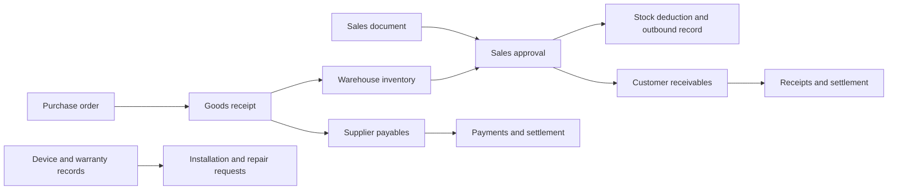
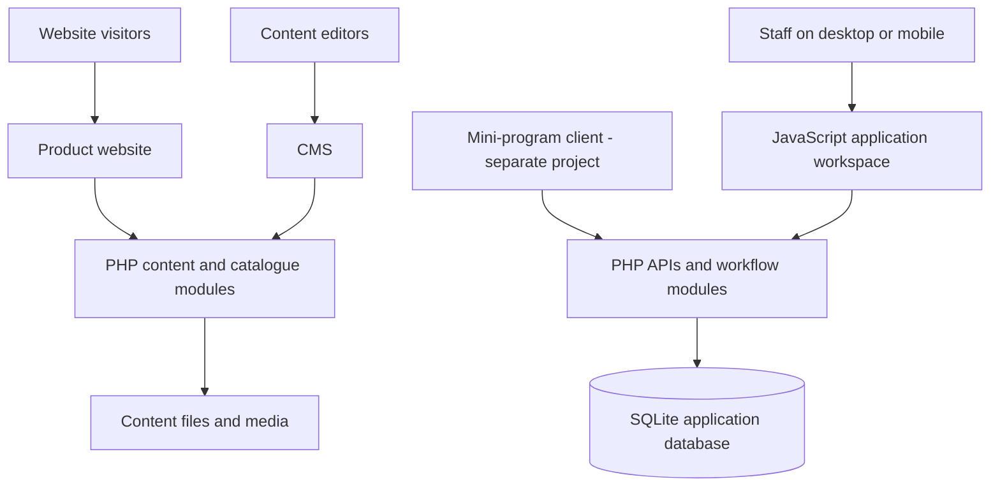

# DEAOE | Lightweight ERP & Product Website

A web-based management platform for a home-appliance business: a public product website and CMS, alongside a **lightweight ERP-style system for purchasing, sales, inventory, settlement, and after-sales service**.

The system helps staff answer practical questions: **What do we have in stock? Which warehouse will fulfil an order? What do customers owe us, what do we owe suppliers, and which service requests still need attention?** It brings these workflows into one desktop- and mobile-friendly workspace.

## What the system does

| Module | What staff can do |
| --- | --- |
| **Sales management** | Create sales documents, select customers and products, set quantities and prices, assign warehouses per item, and preserve delivery details. Approving a sale updates stock and records the receivable. |
| **Purchasing & receiving** | Create purchase orders, receive goods in batches, validate received quantities, and record supplier payables. |
| **Inventory management** | Track stock across warehouses, manage products and batches, handle transfers and returns, and perform stocktaking and inventory adjustments. |
| **Receivables & payables** | Track amounts owed by customers and owed to suppliers, record receipts and payments, and manage advances, refunds, and allocations against documents. |
| **Customer & supplier records** | Maintain reusable contact records for document entry and account tracking. The customer directory shares the sales customer master. |
| **After-sales service** | Manage installation and repair requests, service status, device records, and electronic warranty cards. APIs support mini-program integration. |
| **Product website & CMS** | Publish product categories, series, image galleries, homepage content, and brand information through a separate content-management interface. |

This is a focused operational system for day-to-day appliance sales and service. Its financial module tracks settlement balances; it is not a full general-ledger, payroll, or manufacturing ERP.

## How the business workflow fits together



**Example:** a staff member creates a sale, selects a customer, adds products from one or more warehouses, and records delivery details. Approval validates stock and applies stock deductions and receivable entries within a transaction. Subsequent payments are recorded against the customer's balance. Device and warranty records support the separate after-sales workflow.

## Technical structure



The website handles public presentation and content editing. The application handles operational records through PHP APIs and SQLite. External integrations and runtime content are configured separately.

## Public portfolio scope

This is a standalone, sanitized source snapshot with an independent Git history. It includes generic implementation and synthetic tests, without private commits, production datasets, internal operating manuals, or deployment archives. Contact fields and integration identifiers use demonstration values.

## Updates

- 2026-11-12 — Clearer product field labels with secondary-line helper text.

- 2026-11-12 — Duplicate/create and guarded deletion for counterparties; clearer product category hierarchy.

- 2026-11-12 — Compact counterparty forms and separate customer/supplier category branches.

- 2026-11-12 — Narrower single-window product editor with simpler price labels.

- 2026-11-12 — Custom nested customer categories with inline creation, editing and subtree filtering.

- 2026-11-12 — Unified customer/supplier directory and corrected configurable product numbering previews.

- 2026-11-12 — Settings center with clear configuration cards, aligned business fields and a separate export section.

- 2026-11-12 — Product number previews no longer consume codes on cancel; aligned image upload controls.

- 2026-11-12 — Single-window product editor with compact category/media layout and editable-number hint.

- 2026-11-12 — Bilingual brand configuration, copy-as-new products, compact editor tabs and image-cell upload.

- 2026-11-12: Editable document numbering rules, preallocated form numbers and searchable category destinations.

- 2026-11-12: Added numbering overview, collision-safe product sequences and compact category editing.

Short feature summaries, newest first. Details and validation notes are in the [changelog](CHANGELOG.md).

| Date | Update |
| --- | --- |
| 2026-11-12 | Integrated product image uploads into editing and preserved workspace return destinations. |
| 2026-11-12 | Enabled new products by default and unified legacy links with the current workspace. |
| 2026-11-12 | Blocked saving unconfirmed category drafts and focused newly created products in the catalog. |
| 2026-11-12 | Added configurable product numbering, category moves and linked test-ledger cleanup. |
| 2026-11-12 | Added draggable table columns with server-side, per-account layout preferences. |
| 2026-11-12 | Added stepwise category selection and creation, inherited new-product folders and clearer tree controls. |
| 2026-11-12 | Fixed category-schema upgrades for existing inventory databases. |
| 2026-11-12 | Added hierarchical product categories, descendant filtering and full category paths. |
| 2026-11-12 | Unified navigation, workflow and favorite icons with a consistent local SVG family. |
| 2026-11-12 | Made desktop navigation follow saved favorites instantly, with adjacent star controls. |
| 2026-11-12 | Streamlined desktop service orders and record selectors; added a category-based product directory. |
| 2026-11-12 | Added a desktop inventory workspace with filters and warehouse details; streamlined management labels. |
| 2026-11-12 | Unified desktop purchasing and goods-receipt selectors; refreshed the management-platform footer. |
| 2026-11-12 | Added compact desktop customer, product and warehouse selectors and smaller workflow maps. |
| 2026-11-12 | Added grouped module menus, favorites and seven interactive business workflow maps. |
| 2026-11-12 | Introduced a compact ERP workspace with module navigation, recent pages and aligned forms. |
| 2026-11-12 | Collapsed mobile sales filters to prioritize document browsing. |
| 2026-11-12 | Added consistent ascending/descending business-date sorting for sales and purchases. |
| 2026-11-12 | Simplified desktop customer balances into compact vertical lists. |
| 2026-11-12 | Unified list styling and aligned variable-length balance amounts. |
| 2026-11-12 | Aligned desktop workspace panels and reset scrolling between business pages. |
| 2026-11-12 | Added inclusive business-date filtering to desktop and mobile sales lists. |
| 2026-11-12 | Preloaded the ERP workspace and added short-lived memory snapshots with write invalidation. |
| 2026-11-12 | Improved mobile login input readability and centered layout during focus. |
| 2026-11-11 | Unified compact website footers with aligned desktop information and responsive mobile wrapping. |
| 2026-11-11 | Added carousel edge spacing, demo filing links, and API rate-limit regression coverage. |
| 2026-11-10 | Added direct desktop sales entry and clarified the lightweight ERP modules with workflow diagrams. |
| 2026-11-10 | Published the independent, sanitized source baseline with English documentation and synthetic tests. |

## What this project demonstrates

- **Responsive UI engineering:** mobile navigation, compact record lists, searchable selectors, fixed-header anchor alignment, and touch-driven image galleries with reduced-motion support.
- **Full-stack development:** PHP APIs, SQLite persistence, CMS publishing, document entry, and inventory and account-ledger modules.
- **Data integrity:** transactional updates, repeat-request protection, stock validation, concurrent document numbering, and historical snapshots.
- **Testing:** isolated SQLite regressions, JavaScript interaction checks, and Playwright flows at desktop and mobile viewport sizes.
- **Maintainability:** separated UI/API modules, a repeatable local preview, focused commits, and a concise changelog.

The application UI remains Chinese, reflecting its original users. Project documentation and the engineering history are in English.

## Explore the implementation

| Location | Responsibility |
| --- | --- |
| `src/website/` | Website, product catalogue, image galleries, and CMS |
| `src/service/` | Application UI, API endpoints, and workflow persistence |
| `tests/` | Synthetic backend and browser regression tests |
| `tools/` | Local preview and validation runner |
| `docs/` | Architecture, testing boundaries, and third-party notices |

Suggested reading:

1. [Architecture and source map](docs/SOURCE-MAP.md)
2. [Engineering changelog](CHANGELOG.md)
3. [Test coverage and execution](tests/WEBAPP-TESTING.md)
4. [Public snapshot scope](docs/PRIVACY.md)

## Run a local website preview

Requirements: Python 3.10+, PHP 8.4 with PDO SQLite, GD and mbstring, and Node.js for JavaScript checks.

```sh
python3 tools/preview_website.py
```

Open `http://127.0.0.1:8765`. The terminal prints temporary CMS credentials. The preview runs from a temporary copy; edits are discarded when it exits. Restart the preview after changing source files.

```sh
python3 tools/check.py
```

This runs source syntax checks and isolated regressions. Optional browser tests require Playwright and Google Chrome; see [the testing guide](tests/WEBAPP-TESTING.md).

## Version control

This repository starts with one independently reviewed public baseline. Earlier development milestones are summarized in the changelog, not imported as private Git commits. Every reviewed website and application update, including small fixes, is synchronized here with focused commits, relevant checks, and English changelog entries and a short dated summary in this README’s Updates section. Only allowlisted, sanitized changes are transferred; private history and operational materials are never mirrored.

A push does not deploy an application. This repository supplies no production credentials, infrastructure configuration, or operating runbook.

## Limitations

- Production content and uploaded media are intentionally absent. The default hero image is not included, so the preview is not a complete replica of a deployed website.
- External account integrations require separate configuration; demonstration identifiers do not connect to a real account.
- Mobile browser tests use viewport emulation, not physical-device certification.
- Brand assets are retained for project context. Third-party code notices are in [THIRD_PARTY_LICENSES.txt](docs/THIRD_PARTY_LICENSES.txt).
